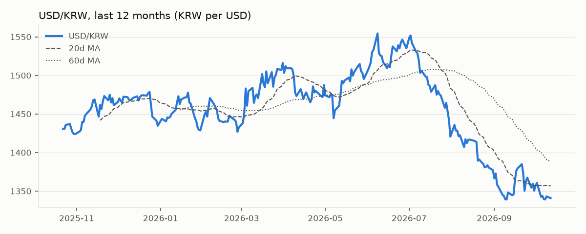
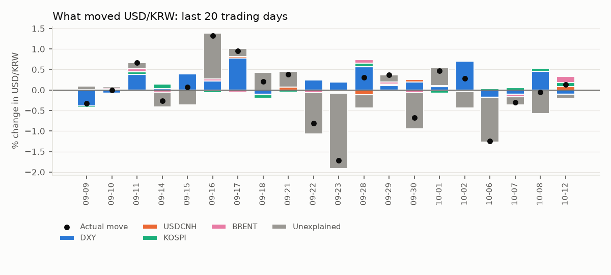
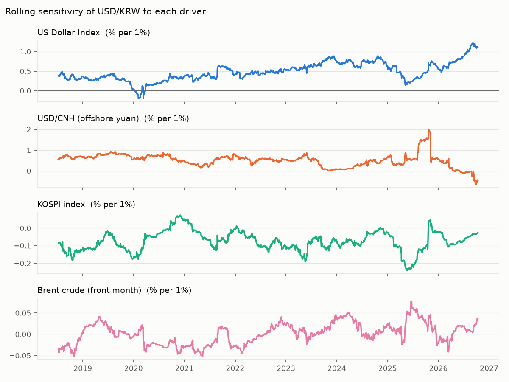

# USD/KRW Driver Note — 2026-10-12

USD/KRW fell 0.16% to 1,340.8 on 12 Oct 2026. The driver model attributes Dollar bloc -0.03pp, Korean equities +0.10pp, Oil +0.15pp; -0.09pp is unexplained (KRW-specific flows or positioning). Largest single bucket: **Oil**.

## Key levels

| Level | Value |
|---|---|
| Last | 1,340.8 |
| 1-day change | -0.16% (z = -0.2 vs 60d vol) |
| 20d / 60d moving average | 1,356.8 / 1,388.5 |
| 1-month range | 1,339.1 – 1,384.9 |
| 3-month range | 1,339.1 – 1,487.4 |
| 20d realised vol (annualised) | 12.2% |

## Attribution

| Bucket | Last day | Last 20 days (cumulative) |
|---|---|---|
| Dollar bloc | -0.03pp | +3.51pp |
| Korean equities | +0.10pp | +0.24pp |
| Oil | +0.15pp | +0.11pp |
| Unexplained (KRW-specific) | -0.09pp | -4.07pp |
| **Actual USD/KRW move** | **+0.13%** | **-0.20%** |

## Current sensitivities

Rolling 120-day betas (point in time). Full-sample betas use Newey-West (HAC) t-stats.

| Driver | Rolling beta (now) | Full-sample beta | t-stat |
|---|---|---|---|
| US Dollar Index (% per 1%) | +1.109 | +0.517 | +12.6 |
| USD/CNH (offshore yuan) (% per 1%) | -0.461 | +0.410 | +6.9 |
| KOSPI index (% per 1%) | -0.027 | -0.061 | -6.8 |
| Brent crude (front month) (% per 1%) | +0.037 | -0.003 | -0.5 |

## How reliable is this?

- Out-of-sample explained share of daily moves: **28%** (betas estimated through the previous day only; 1,956 days).
- In-sample R² for comparison: 29% — optimistic by construction.
- Sign of the move matched on **69%** of days.
- This is attribution, not a forecast: same-day drivers explain same-day moves.
- Timing: USD/KRW is matched with the previous New York session for DXY, US yields and oil, and with the same Seoul session for KOSPI. Close times still differ, so read 20-day totals with more confidence than single days.
