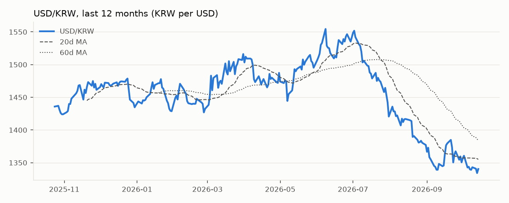
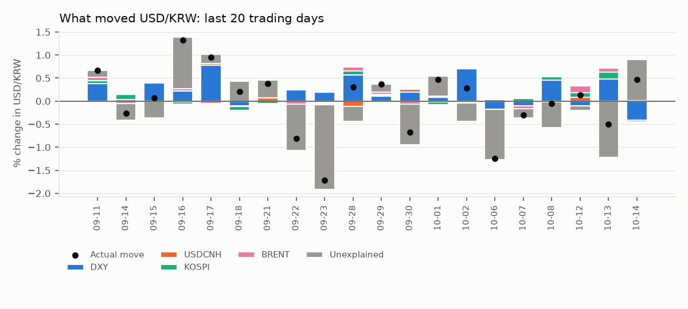
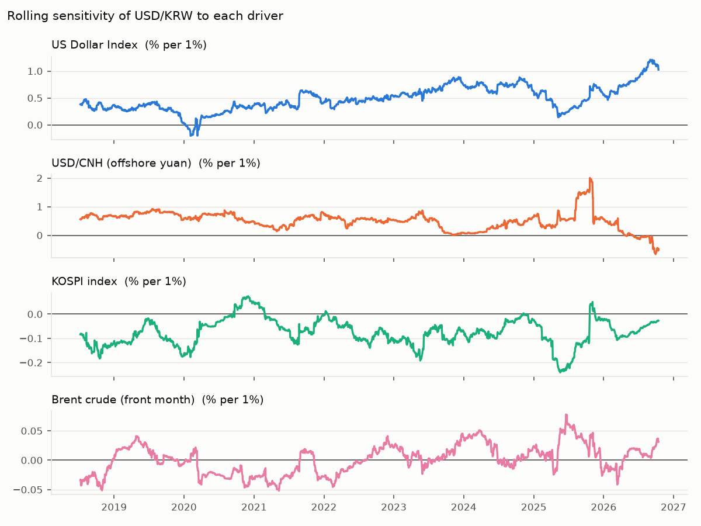

# USD/KRW Driver Note — 2026-10-14

USD/KRW rose 0.46% to 1,340.3 on 14 Oct 2026. The driver model attributes Dollar bloc -0.42pp, Korean equities +0.01pp, Oil -0.03pp; +0.90pp is unexplained (KRW-specific flows or positioning). Largest single bucket: **Unexplained (KRW-specific)**.

## Key levels

| Level | Value |
|---|---|
| Last | 1,340.3 |
| 1-day change | +0.46% (z = +0.7 vs 60d vol) |
| 20d / 60d moving average | 1,355.0 / 1,383.8 |
| 1-month range | 1,334.1 – 1,384.9 |
| 3-month range | 1,334.1 – 1,487.4 |
| 20d realised vol (annualised) | 11.3% |

## Attribution

| Bucket | Last day | Last 20 days (cumulative) |
|---|---|---|
| Dollar bloc | -0.42pp | +4.04pp |
| Korean equities | +0.01pp | +0.44pp |
| Oil | -0.03pp | +0.11pp |
| Unexplained (KRW-specific) | +0.90pp | -4.51pp |
| **Actual USD/KRW move** | **+0.46%** | **+0.09%** |

## Current sensitivities

Rolling 120-day betas (point in time). Full-sample betas use Newey-West (HAC) t-stats.

| Driver | Rolling beta (now) | Full-sample beta | t-stat |
|---|---|---|---|
| US Dollar Index (% per 1%) | +1.025 | +0.516 | +12.6 |
| USD/CNH (offshore yuan) (% per 1%) | -0.484 | +0.411 | +6.9 |
| KOSPI index (% per 1%) | -0.027 | -0.060 | -6.7 |
| Brent crude (front month) (% per 1%) | +0.031 | -0.004 | -0.6 |

## How reliable is this?

- Out-of-sample explained share of daily moves: **27%** (betas estimated through the previous day only; 1,958 days).
- In-sample R² for comparison: 29% — optimistic by construction.
- Sign of the move matched on **69%** of days.
- This is attribution, not a forecast: same-day drivers explain same-day moves.
- Timing: USD/KRW is matched with the previous New York session for DXY, US yields and oil, and with the same Seoul session for KOSPI. Close times still differ, so read 20-day totals with more confidence than single days.
