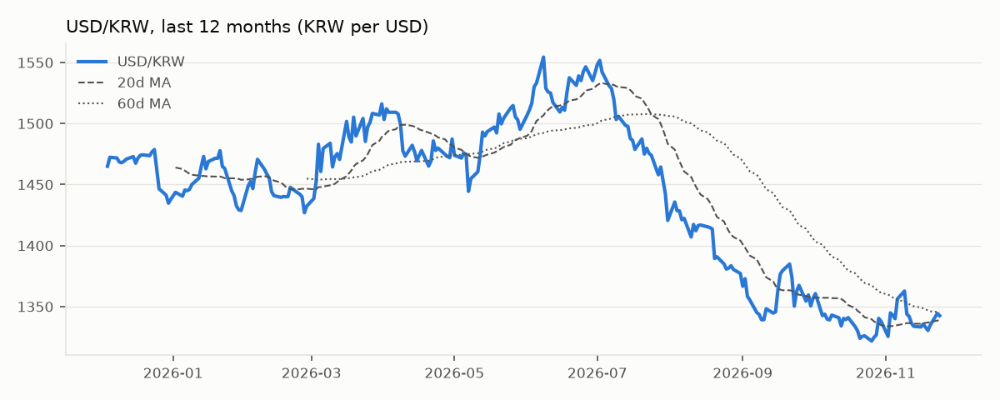
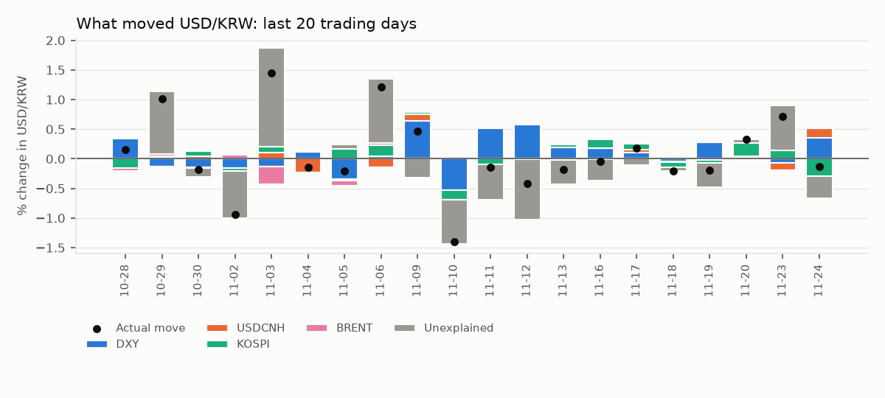
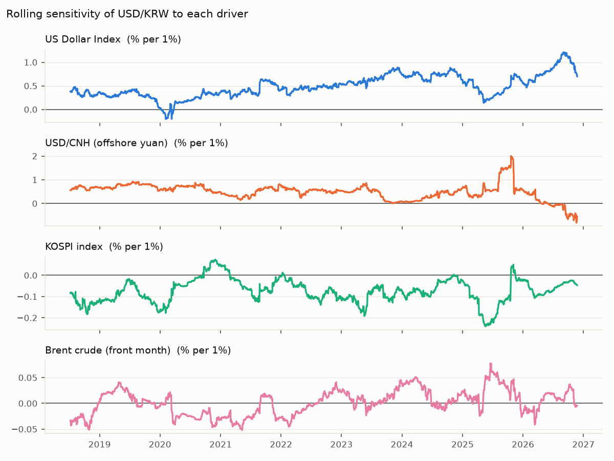

# USD/KRW Driver Note — 2026-11-24

USD/KRW fell 0.14% to 1,342.5 on 24 Nov 2026. The driver model attributes Dollar bloc +0.52pp, Korean equities -0.29pp, Oil +0.01pp; -0.38pp is unexplained (KRW-specific flows or positioning). Largest single bucket: **Dollar bloc**.

## Key levels

| Level | Value |
|---|---|
| Last | 1,342.5 |
| 1-day change | -0.14% (z = -0.2 vs 60d vol) |
| 20d / 60d moving average | 1,339.4 / 1,345.1 |
| 1-month range | 1,324.8 – 1,362.7 |
| 3-month range | 1,321.8 – 1,384.9 |
| 20d realised vol (annualised) | 10.7% |

## Attribution

| Bucket | Last day | Last 20 days (cumulative) |
|---|---|---|
| Dollar bloc | +0.52pp | +1.85pp |
| Korean equities | -0.29pp | +0.39pp |
| Oil | +0.01pp | -0.30pp |
| Unexplained (KRW-specific) | -0.38pp | -0.61pp |
| **Actual USD/KRW move** | **-0.14%** | **+1.33%** |

## Current sensitivities

Rolling 120-day betas (point in time). Full-sample betas use Newey-West (HAC) t-stats.

| Driver | Rolling beta (now) | Full-sample beta | t-stat |
|---|---|---|---|
| US Dollar Index (% per 1%) | +0.701 | +0.514 | +12.7 |
| USD/CNH (offshore yuan) (% per 1%) | -0.537 | +0.411 | +6.9 |
| KOSPI index (% per 1%) | -0.047 | -0.060 | -6.9 |
| Brent crude (front month) (% per 1%) | -0.004 | -0.004 | -0.7 |

## How reliable is this?

- Out-of-sample explained share of daily moves: **27%** (betas estimated through the previous day only; 1,987 days).
- In-sample R² for comparison: 29% — optimistic by construction.
- Sign of the move matched on **69%** of days.
- This is attribution, not a forecast: same-day drivers explain same-day moves.
- Timing: USD/KRW is matched with the previous New York session for DXY, US yields and oil, and with the same Seoul session for KOSPI. Close times still differ, so read 20-day totals with more confidence than single days.
